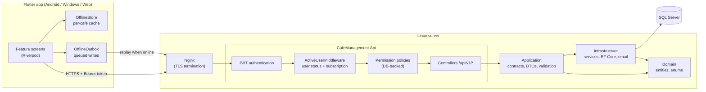

# Cafi Manager — Multi-Tenant Café Management Platform

A SaaS platform that lets café owners run day-to-day operations — table sessions, customers, sales, inventory, staff and finances — from one app on Android, Windows and the web, with each café's data fully isolated from every other café.

> **Full source code is private (commercial product) — available for review on request.**
> This repository contains the documentation and selected code samples in [`samples/`](samples/).

---

## Screenshots

> Screenshots are captured from a demo café with fake data.

| Dashboard | Sessions | Customers |
|---|---|---|
|  |  |  |

| Inventory | Reports | Roles & permissions |
|---|---|---|
|  |  |  |

---

## Key features

- **Multi-tenant cafés** — every user, role, customer, product and transaction belongs to a single café (`CafeId`).
- **Sessions** — open/close/cancel table sessions, with table types, internet types and electricity pricing (hourly or fixed).
- **Customers** — customer records, soft delete, and customer subscription plans with payment tracking.
- **Catalog & inventory** — products, categories, consumption packages, stock movements, and recipe-based stock deduction (`ProductInventoryRecipeLine`).
- **Billing & finance** — financial transactions, expenses, salaries, staff advances, payment wallets, and shift handover reconciliation of wallet balances.
- **Reports** — period payments, product sales, wallet payments and guest statistics.
- **Users, roles & permissions** — custom roles per café built from 47 permission codes.
- **Platform administration** — super-admin management of café subscriptions (trial / active / expired).
- **Notifications & activity log** — per-café notifications and an audit trail of user actions.
- **Authentication** — email/password (BCrypt), Google Sign-In, and password reset by email.
- **Offline-first client** — cached reads and a persistent queue of offline writes that is replayed when the connection returns.
- **In-app updates** — the client checks the API for the latest version and downloads it (Android / Windows).

---

## Tech stack

| Layer | Technologies |
|---|---|
| Backend | ASP.NET Core 8 Web API, EF Core 8 (SQL Server), FluentValidation, JWT Bearer, Google.Apis.Auth, BCrypt.Net, Swagger |
| Client | Flutter (Android, Windows, Web), Riverpod, Dio, sembast (local DB), flutter_secure_storage |
| Tests | xUnit |
| Hosting | Linux (systemd service) behind Nginx, SQL Server |

---

## Architecture

The backend follows a layered (Clean Architecture–style) structure: `Domain` has no dependencies, `Application` defines contracts and DTOs, `Infrastructure` implements them with EF Core, and `Api` exposes them over HTTP.

| Project | Responsibility |
|---|---|
| `src/CafeManagement.Domain` | Entities and enums |
| `src/CafeManagement.Application` | Service interfaces, DTOs, validators, permission codes |
| `src/CafeManagement.Infrastructure` | EF Core `AppDbContext`, migrations, services, authorization handlers, seeding |
| `src/CafeManagement.Api` | Controllers, middleware, authorization policies, startup |
| `cafe_management_app` | Flutter client, organised by feature under `lib/features` |
| `tests/CafeManagement.Tests` | xUnit tests |
| `tool` | Deployment, database backup/restore and migration-check scripts |

---

## Engineering highlights

### 1. Permission checks that take effect immediately
- **Problem:** Putting permissions inside the JWT means a revoked permission keeps working until the token expires.
- **Decision:** Tokens only identify the user. Every protected endpoint uses a `Permission:<code>` policy whose handler checks the user's current role permissions in the database. A custom policy provider builds `AnyPermission:A,B` (OR) policies on demand, so endpoints shared by several roles don't need every combination registered up front.
- **Result:** Changing a role or disabling a user applies on the next request, with no re-login needed.
- **Files (private repo):** `Program.cs`, `PermissionAuthorizationHandler.cs`, `AnyPermissionPolicyProvider.cs`, `AnyPermissionAuthorizationHandler.cs`, `PermissionCodes.cs`
- **Public sample:** [`samples/01-permission-authorization/`](samples/01-permission-authorization/)

### 2. Tenant isolation by design
- **Problem:** Many cafés share one database, and one café must never see another café's data.
- **Decision:** Every business entity carries a `CafeId` foreign key, and uniqueness is scoped per café (for example, a unique index on `(CafeId, Email)` for users). Services resolve the café from the authenticated user on the server (`UserCafeProvider.cs`) and never accept a café ID from the client.
- **Result:** Two cafés can have products, roles or users with the same names, and requests are always scoped to the caller's café.
- **Files (private repo):** `AppDbContext.cs`, `UserCafeProvider.cs`
- **Public sample:** [`samples/02-tenant-isolation/`](samples/02-tenant-isolation/)

### 3. Account and subscription enforcement in one place
- **Problem:** Deactivated users and cafés with expired trials or subscriptions must be blocked consistently across about 20 controllers.
- **Decision:** A single middleware runs after authentication. It rejects inactive users and expired trials or subscriptions with machine-readable error codes (`AUTH_USER_INACTIVE`, `TRIAL_EXPIRED`, `SUBSCRIPTION_EXPIRED`) plus the support details the client needs. Platform super-admins are exempt.
- **Result:** No controller has to repeat these checks, and the client can show a precise message for each case.
- **Files (private repo):** `ActiveUserMiddleware.cs`, `SuperAdminGuard.cs`

### 4. Offline-first client
- **Problem:** Cafés often have unreliable connectivity, but staff still need to see data and record work.
- **Decision:**
  - Reads use stale-while-revalidate: cached data is shown instantly, refreshed in the background, and the UI only rebuilds when the data actually changes.
  - Cache keys are namespaced per café and wiped on logout.
  - Writes made offline go into a persistent outbox that maps temporary offline IDs to server IDs when replayed.
- **Result:** Screens open instantly and data from one café never leaks into another account on a shared device.
- **Files (private repo):** `stale_while_revalidate.dart`, `offline_store.dart`, `offline_outbox.dart`
- **Public sample:** [`samples/04-offline-first/`](samples/04-offline-first/)

### 5. Safe, repeatable deployments
- **Problem:** Schema changes and new permissions must reach production without manual SQL.
- **Decision:**
  - EF Core migrations are applied on startup.
  - A safe-to-rerun bootstrapper adds any new permission codes and grants them to the built-in Admin roles.
  - The API refuses to start without a JWT signing key of at least 32 characters.
  - Scripts cover publishing for Linux, deploying while preserving the server's config files, database backup/restore and migration checks.
- **Result:** Releases are a single scripted step and new features don't require hand-editing permission tables.
- **Files (private repo):** `PermissionBootstrapper.cs`, `Migrations`, `tool/`
- **Public sample:** [`samples/03-permission-bootstrapper/`](samples/03-permission-bootstrapper/)

---

## Security

- **Authentication:** JWT Bearer tokens, validated for issuer, audience, lifetime and signing key. Passwords are hashed with BCrypt. Google Sign-In tokens are verified server-side, and password reset uses expiring single-use tokens.
- **Authorization:** role-based, with fine-grained permission codes checked against the database on each request (see highlight 1).
- **Tenant isolation:** every request is scoped to the user's café on the server (see highlight 2).
- **Account state:** inactive users and expired subscriptions are blocked centrally (see highlight 3).
- **Secrets:** production configuration lives only on the server and is never committed. The private repository contains a placeholder example only (`appsettings.Production.json.example`). Any value can be overridden with environment variables (e.g. `Jwt__SigningKey`, `ConnectionStrings__Default`).
- **Client storage:** on Windows the token is kept in `flutter_secure_storage`. On Android and web it is kept in `SharedPreferences`, a deliberate trade-off because secure storage could hang on some devices (`token_storage.dart`). Local caches are cleared on logout.

---

## Source code & samples

Full source code is private (commercial product) — available for review on request.

| Sample | What it demonstrates |
|---|---|
| [`01-permission-authorization`](samples/01-permission-authorization/) | Database-backed permission policies, including runtime-built "any of" policies |
| [`02-tenant-isolation`](samples/02-tenant-isolation/) | Server-side café resolution and per-tenant queries, indexes and keys |
| [`03-permission-bootstrapper`](samples/03-permission-bootstrapper/) | Safe-to-rerun startup step that adds new permissions without anyone losing access |
| [`04-offline-first`](samples/04-offline-first/) | Per-café cache and stale-while-revalidate loading in Flutter |

Samples are copied verbatim from the private repository with an English header added. Some inline comments are in Arabic.

---

## My role

Designed, built, deployed and maintained end-to-end by Reem Mansour.

## Author

**Reem Mansour**
- Website: https://rovira.dev
- LinkedIn: https://linkedin.com/in/reem-mansour-a76938247

---

© Reem Mansour. All rights reserved.
